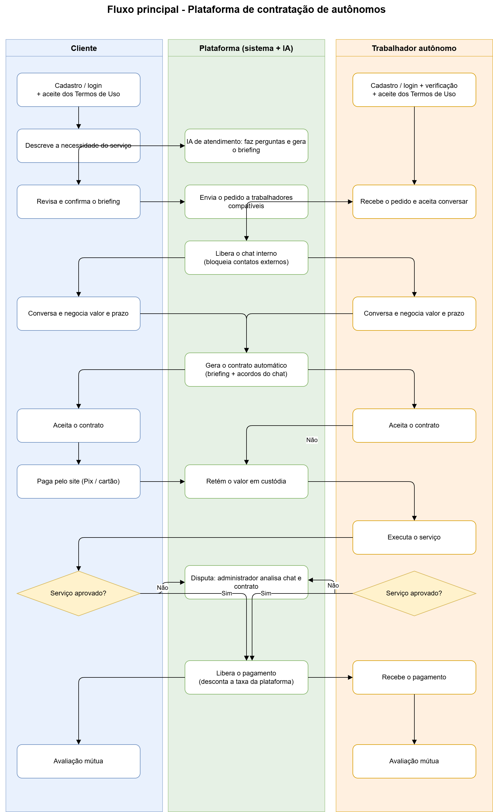
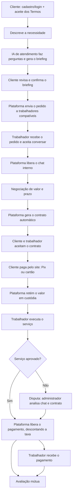
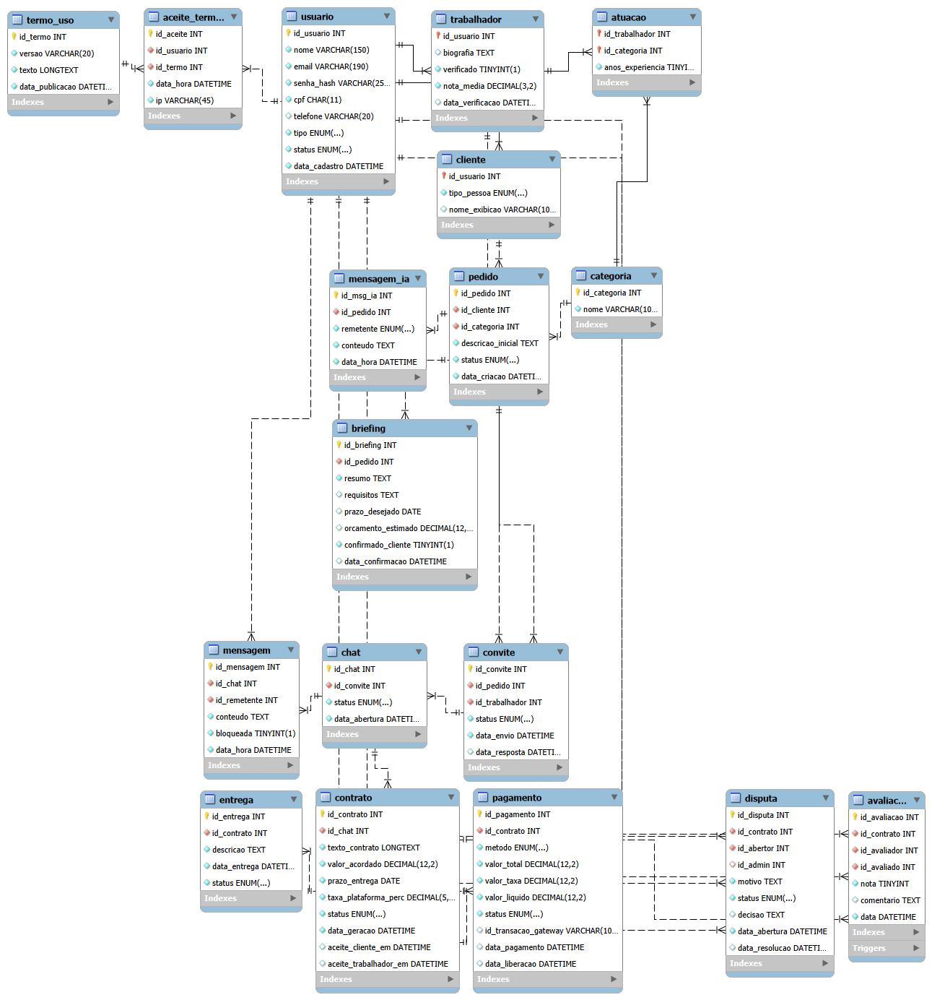

# 🐐 GoatWork

> **Plataforma de contratação de trabalhadores autônomos com atendimento por IA, contrato automático e pagamento protegido em custódia.**


---

## 📑 Sumário

1. [Visão geral](#-visão-geral)
2. [O problema](#-o-problema)
3. [A solução](#-a-solução)
4. [Fluxo do sistema](#-fluxo-do-sistema)
5. [Funcionalidades](#-funcionalidades)
6. [Perfis de usuário](#-perfis-de-usuário)
7. [Regras de negócio](#-regras-de-negócio)
8. [Modelagem de dados](#-modelagem-de-dados)
   - [DER](#81-der--diagrama-entidade-relacionamento)
   - [MER: entidades e atributos](#82-mer--entidades-e-atributos)
   - [MER: relacionamentos](#83-mer--relacionamentos)
   - [Estados importantes](#84-estados-importantes)
9. [Modelo de receita](#-modelo-de-receita)
10. [Segurança e responsabilidade legal](#-segurança-e-responsabilidade-legal)
11. [Estrutura do repositório](#-estrutura-do-repositório)
12. [Roadmap](#-roadmap)
13. [Equipe](#-equipe)

---

## 🎯 Visão geral

O **GoatWork** conecta **clientes** que precisam de um serviço a **trabalhadores autônomos** qualificados, de forma segura e organizada. Todo o processo acontece dentro da plataforma: do primeiro contato ao pagamento.

| | |
|---|---|
| **Nome do projeto** | GoatWork |
| **Tipo** | Marketplace de serviços autônomos (web) |
| **Público-alvo** | Pessoas e empresas que contratam serviços + profissionais autônomos |
| **Diferencial** | Briefing por IA, chat interno monitorado, contrato automático e pagamento em custódia |

---

## ⚠️ O problema

A contratação de autônomos hoje costuma ter quatro dores recorrentes:

- **Pedidos mal descritos**: o cliente não sabe explicar o que precisa e o profissional perde tempo entendendo.
- **Negociações fora da plataforma**: contatos trocados por fora tiram a proteção de ambas as partes.
- **Acordos verbais**: sem registro, surgem desentendimentos sobre valor, prazo e escopo.
- **Calote e má-fé**: o cliente não paga ou o profissional recebe e não entrega.

---

## 💡 A solução

O GoatWork resolve cada dor com um mecanismo específico:

| Dor | Solução no GoatWork |
|---|---|
| Pedido mal descrito | **IA de atendimento** faz perguntas ao cliente e gera um **briefing** estruturado |
| Negociação por fora | **Chat interno** com bloqueio de contatos externos (telefone, e-mail, etc.) |
| Acordo verbal | **Contrato automático** gerado a partir do briefing + acordos feitos no chat, com aceite das duas partes |
| Calote / má-fé | **Pagamento em custódia**: o valor fica retido e só é liberado após a aprovação do serviço |
| Conflitos | **Disputa** analisada por um administrador, com acesso ao chat e ao contrato |

---

## 🔄 Fluxo do sistema

O diagrama abaixo mostra o fluxo principal em três raias: **Cliente**, **Plataforma (sistema + IA)** e **Trabalhador autônomo**.



> Arquivo editável: [`diagramas/escopo-GoatWork.drawio`](./diagramas/escopo-GoatWork.drawio)

<details>
<summary>📝 Ver o mesmo fluxo em versão texto (Mermaid)</summary>



</details>

### Resumo em 5 fases

| # | Fase | O que acontece |
|---|---|---|
| 1 | **Cadastro e termos** | Usuário se cadastra, é verificado e aceita os Termos de Uso |
| 2 | **Pedido e briefing** | O cliente conversa com a IA, que gera o briefing do serviço |
| 3 | **Convite e chat** | O pedido é enviado a trabalhadores compatíveis; se um aceitar, o chat é liberado |
| 4 | **Contrato, pagamento e entrega** | Contrato automático, pagamento em custódia e execução do serviço |
| 5 | **Disputa e avaliação** | Aprovação (ou disputa) e avaliação mútua ao final |

---

## ✨ Funcionalidades

### Para o cliente
- Cadastro com aceite dos Termos de Uso
- Atendimento por IA que transforma uma ideia vaga em briefing claro
- Revisão e confirmação do briefing antes do envio
- Chat interno com o trabalhador
- Contrato gerado automaticamente
- Pagamento pelo site (Pix ou cartão)
- Aprovação ou contestação do serviço entregue
- Avaliação do trabalhador

### Para o trabalhador autônomo
- Cadastro com **verificação** de identidade e aceite dos Termos
- Perfil com biografia, categorias de atuação e anos de experiência
- Recebimento de pedidos compatíveis com suas categorias
- Escolha de quais pedidos aceitar conversar
- Contrato e pagamento garantidos antes de começar
- Recebimento do valor líquido após a aprovação
- Reputação construída por avaliações (nota média)

### Para a plataforma / administração
- Controle de versões dos Termos de Uso e registro de aceite (com data, hora e IP)
- Bloqueio e marcação de mensagens com contato externo
- Gestão de custódia e liberação de pagamentos
- Mediação de disputas com decisão registrada
- Cobrança automática da taxa da plataforma

---

## 👥 Perfis de usuário

| Perfil | Papel |
|---|---|
| **Cliente** | Cria pedidos, negocia, paga e avalia. Pode ser pessoa física ou jurídica. |
| **Trabalhador autônomo** | Recebe pedidos, negocia, executa o serviço, recebe e avalia. |
| **Administrador** | Resolve disputas e supervisiona a plataforma. |

---

## 📏 Regras de negócio

1. **Termos obrigatórios**: o usuário só é ativado após ter um registro de aceite dos Termos de Uso (inclui a isenção de responsabilidade da plataforma).
2. **Briefing confirmado**: o pedido só é enviado a trabalhadores depois que o cliente confirma o briefing gerado pela IA (`confirmado_cliente = verdadeiro`).
3. **Chat condicionado**: o chat só existe se o convite tiver status `ACEITO`. Mensagens com contato externo são marcadas em `MENSAGEM.bloqueada`.
4. **Contrato válido**: o contrato só tem validade quando `aceite_cliente_em` e `aceite_trabalhador_em` estão preenchidos.
5. **Pagamento protegido**: o pagamento fica `EM_CUSTODIA` e só é `LIBERADO` após a entrega ser **aprovada** ou a disputa ser **decidida por um administrador**.
6. **Cálculo do repasse**: `valor_liquido = valor_total − valor_taxa`.
7. **Avaliação justa**: cada usuário só pode avaliar a outra parte de um contrato **concluído**, com uma avaliação por avaliador por contrato.
8. **Nova entrega**: se uma entrega for rejeitada, o trabalhador pode enviar outra no mesmo contrato.

---

## 🗄️ Modelagem de dados

O banco foi modelado em **19 entidades**, organizadas pelas 5 fases do fluxo.

**Notação:** **PK** = chave primária · *FK* = chave estrangeira · cardinalidades no formato (mín,máx).

### 8.1 DER – Diagrama Entidade-Relacionamento

O DER segue o fluxo do sistema, de cima para baixo (fases 1 a 5). Caixas tracejadas são repetições de uma entidade já mostrada, usadas só para evitar linhas cruzadas, e as linhas animadas indicam o caminho principal do serviço.



### 8.2 MER – Entidades e atributos

#### Fase 1 · Cadastro e termos de uso

| Entidade | Atributos | Observações |
|---|---|---|
| **USUARIO** | **id_usuario**, nome, email, senha_hash, cpf, telefone, tipo, status, data_cadastro | Generalização total/disjunta: todo usuário é `CLIENTE`, `TRABALHADOR` ou `ADMIN` (campo `tipo`) |
| **CLIENTE** | **id_usuario**, tipo_pessoa, nome_exibicao | *id_usuario* → USUARIO |
| **TRABALHADOR** | **id_usuario**, biografia, verificado, nota_media, data_verificacao | *id_usuario* → USUARIO |
| **TERMO_USO** | **id_termo**, versao, texto, data_publicacao | Versões dos Termos de Uso |
| **ACEITE_TERMOS** | **id_aceite**, *id_usuario*, *id_termo*, data_hora, ip | Prova de que cada usuário aceitou os termos (inclusive a isenção de responsabilidade) |
| **CATEGORIA** | **id_categoria**, nome | Áreas de serviço |
| **ATUACAO** | ***id_trabalhador***, ***id_categoria***, anos_experiencia | Entidade associativa TRABALHADOR × CATEGORIA |

#### Fase 2 · Pedido e briefing com a IA

| Entidade | Atributos | Observações |
|---|---|---|
| **PEDIDO** | **id_pedido**, *id_cliente*, *id_categoria*, descricao_inicial, status, data_criacao | Necessidade descrita pelo cliente |
| **MENSAGEM_IA** | **id_msg_ia**, *id_pedido*, remetente, conteudo, data_hora | Conversa entre o cliente e a IA de atendimento |
| **BRIEFING** | **id_briefing**, *id_pedido*, resumo, requisitos, prazo_desejado, orcamento_estimado, confirmado_cliente, data_confirmacao | Resumo estruturado gerado pela IA |

#### Fase 3 · Convite e chat interno

| Entidade | Atributos | Observações |
|---|---|---|
| **CONVITE** | **id_convite**, *id_pedido*, *id_trabalhador*, status, data_envio, data_resposta | Associativa PEDIDO × TRABALHADOR |
| **CHAT** | **id_chat**, *id_convite*, status, data_abertura | Só existe se o convite for aceito |
| **MENSAGEM** | **id_mensagem**, *id_chat*, *id_remetente*, conteudo, bloqueada, data_hora | `bloqueada` marca contato externo |

#### Fase 4 · Contrato, pagamento e entrega

| Entidade | Atributos | Observações |
|---|---|---|
| **CONTRATO** | **id_contrato**, *id_chat*, texto_contrato, valor_acordado, prazo_entrega, taxa_plataforma_perc, status, data_geracao, aceite_cliente_em, aceite_trabalhador_em | Gerado a partir do briefing + acordos do chat |
| **PAGAMENTO** | **id_pagamento**, *id_contrato*, metodo, valor_total, valor_taxa, valor_liquido, status, id_transacao_gateway, data_pagamento, data_liberacao | Status: `PENDENTE → EM_CUSTODIA → LIBERADO` (ou `ESTORNADO`) |
| **ENTREGA** | **id_entrega**, *id_contrato*, descricao, data_entrega, status | Permite nova entrega após rejeição |

#### Fase 5 · Disputa e avaliação

| Entidade | Atributos | Observações |
|---|---|---|
| **DISPUTA** | **id_disputa**, *id_contrato*, *id_abertor*, *id_admin*, motivo, status, decisao, data_abertura, data_resolucao | Aberta por uma das partes e resolvida por um administrador |
| **AVALIACAO** | **id_avaliacao**, *id_contrato*, *id_avaliador*, *id_avaliado*, nota, comentario, data | Nota de 1 a 5 |

### 8.3 MER – Relacionamentos

| # | Relacionamento | Entidades | Cardinalidade |
|---|---|---|---|
| 1 | aceita | USUARIO – ACEITE_TERMOS | 1:N: usuário (1,1) … aceite (0,N) |
| 2 | é aceito em | TERMO_USO – ACEITE_TERMOS | 1:N |
| 3 | é | USUARIO – CLIENTE / TRABALHADOR | 1:1 (especialização) |
| 4 | cria | CLIENTE – PEDIDO | 1:N: cliente (0,N) … pedido (1,1) |
| 5 | classifica | CATEGORIA – PEDIDO | 1:N |
| 6 | atua em | TRABALHADOR – CATEGORIA | N:N, resolvido por ATUACAO |
| 7 | tem | PEDIDO – MENSAGEM_IA | 1:N |
| 8 | gera | PEDIDO – BRIEFING | 1:1 (briefing só existe a partir de um pedido) |
| 9 | é enviado a / recebe | PEDIDO – TRABALHADOR | N:N, resolvido por CONVITE |
| 10 | libera | CONVITE – CHAT | 1:1 (chat só abre se o trabalhador aceitar conversar) |
| 11 | contém | CHAT – MENSAGEM | 1:N |
| 12 | envia | USUARIO – MENSAGEM | 1:N |
| 13 | origina | CHAT – CONTRATO | 1:1 (contrato gerado a partir do briefing + acordos do chat) |
| 14 | é pago por | CONTRATO – PAGAMENTO | 1:1 |
| 15 | tem | CONTRATO – ENTREGA | 1:N (permite nova entrega após rejeição) |
| 16 | pode gerar | CONTRATO – DISPUTA | 1:N |
| 17 | abre / resolve | USUARIO – DISPUTA | 1:N em cada papel (abertor e admin) |
| 18 | recebe | CONTRATO – AVALIACAO | 1:N (máx. 2: cliente→trabalhador e trabalhador→cliente) |
| 19 | avalia / é avaliado em | USUARIO – AVALIACAO | 1:N em cada papel |

### 8.4 Estados importantes

| Entidade | Estados |
|---|---|
| `CONVITE` | `ENVIADO` · `ACEITO` · `RECUSADO` |
| `PAGAMENTO` | `PENDENTE` · `EM_CUSTODIA` · `LIBERADO` · `ESTORNADO` |
| `ENTREGA` | `PENDENTE` · `APROVADA` · `REJEITADA` |

---

## 💰 Modelo de receita

A plataforma cobra uma **taxa percentual sobre cada serviço contratado**, descontada automaticamente no momento da liberação do pagamento.

```
Exemplo (taxa ilustrativa de 10%):
Valor acordado ........ R$ 500,00
Taxa da plataforma .... R$  50,00
Trabalhador recebe .... R$ 450,00
```

O percentual fica registrado em cada contrato (`taxa_plataforma_perc`), o que permite ajustar a política de taxas sem afetar contratos antigos.

---

## 🔒 Segurança e responsabilidade legal

- **Termos de Uso**: exibidos no login/cadastro. Informam que a plataforma **não se responsabiliza por danos causados durante a execução do trabalho**. O aceite é registrado com data, hora e IP, servindo como prova.
- **Verificação de trabalhadores**: indicador de perfil verificado e data de verificação.
- **Pagamento em custódia**: protege o cliente contra não entrega e o trabalhador contra calote.
- **Chat monitorado**: bloqueio de contatos externos mantém a negociação, e o histórico, dentro da plataforma.
- **Senhas**: armazenadas apenas como hash (`senha_hash`).
- **Rastreabilidade**: contrato, chat, entregas e decisões de disputa ficam registrados.

> ⚖️ **Aviso:** os Termos de Uso devem ser revisados por um profissional jurídico antes da operação real. Cláusulas de limitação de responsabilidade têm limites previstos em lei (como o Código de Defesa do Consumidor) e não substituem as proteções do contrato e da custódia.

---

## 📂 Estrutura do repositório

```
GoatWork/
├── README.md
├── MER-GoatWork.md
└── diagramas/
    ├── DER.GoatWork.png
    ├── escopo-GoatWork.drawio
    └── escopo-GoatWork.png
```

| Arquivo | Conteúdo |
|---|---|
| `README.md` | Visão geral do projeto (este documento) |
| `MER-GoatWork.md` | Modelo Entidade-Relacionamento em arquivo próprio (entidades, atributos, relacionamentos e regras) |
| `diagramas/escopo-GoatWork.drawio` | Fluxograma do sistema com raias: Cliente, Plataforma (sistema + IA) e Trabalhador |
| `diagramas/DER-GoatWork.drawio` | Diagrama Entidade-Relacionamento organizado nas 5 fases do fluxo |
| `diagramas/*.png` | Imagens exportadas dos diagramas, exibidas neste README |

> Os arquivos `.drawio` abrem em [app.diagrams.net](https://app.diagrams.net) ou na extensão Draw.io do VS Code. Ao alterar um diagrama, exporte a imagem de novo e substitua o `.png` correspondente.

---

## 🗺️ Roadmap

- [x] Definição da ideia e do escopo
- [x] Fluxo principal do sistema
- [x] Modelo conceitual (MER) e diagrama (DER)
- [x] Definição da stack tecnológica
- [x] Modelo físico do banco de dados (scripts SQL)
- [ ] Protótipo das telas (cadastro, chat, contrato, pagamento)
- [ ] Integração com a IA de atendimento
- [ ] Integração com gateway de pagamento (Pix e cartão)
- [ ] Painel do administrador (disputas)
- [ ] Testes e validação
- [ ] Publicação

---

## 👨‍💻 Equipe

| Integrante |
|---|
| Arthur Felis |
| Gabriel Almeida |
| João Mota |
| Kaue Almeida |
| Ruan Pablo |

---

<p align="center">
  <b>GoatWork</b> · Contratação de autônomos com segurança do início ao fim 🐐
</p>
